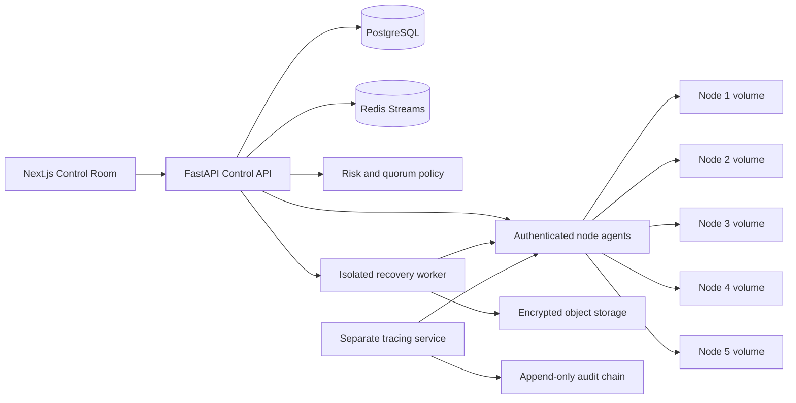

# RiskShare architecture

RiskShare separates the control plane from the data plane. The control plane owns identity, vault metadata, risk policy, recovery orchestration, epoch state, and audit records. Independent node agents hold one share each. A restricted recovery worker gathers authorized shares, reconstructs a DEK in process memory, and decrypts the object; neither the frontend nor ordinary API responses receive the DEK.

The first implementation milestone is deliberately narrower: an isolated Python ABSS-I module, mathematically checked against the paper's reconstruction and modulus conditions. API, database, distributed nodes, TTSS-II group construction, and UI are later milestones. Five local containers are not physical fault domains. Until authenticated inter-service transport, secret handling, deployment isolation, and independent storage are implemented and reviewed, this repository is a research prototype and must not protect production secrets.

## Cryptographic epoch boundary

Every share set belongs to an immutable epoch and threshold. A threshold change requires a fresh DEK, ciphertext, and share generation, followed by distribution verification and atomic activation. Recovery is frozen during a critical transition. Failure leaves the old active epoch intact and blocks recovery if its safety cannot be established; it never silently relabels old shares. Rotation protects future ciphertext and does not revoke copies of older ciphertext or keys.

## ABSS-I milestone

The implementation uses distinct prime moduli (hence pairwise coprime), a prime `m0` larger than the nonnegative secret, additive components, CRT reconstruction, and the paper's strict Asmuth–Bloom inequality. It rejects fewer than `t` shares and mixed/malformed share sets. ABSS has no share authentication: a tampered share is not intrinsically detectable. TTSS-I and TTSS-II remain unimplemented until their tracing and group assumptions have dedicated designs and tests.
